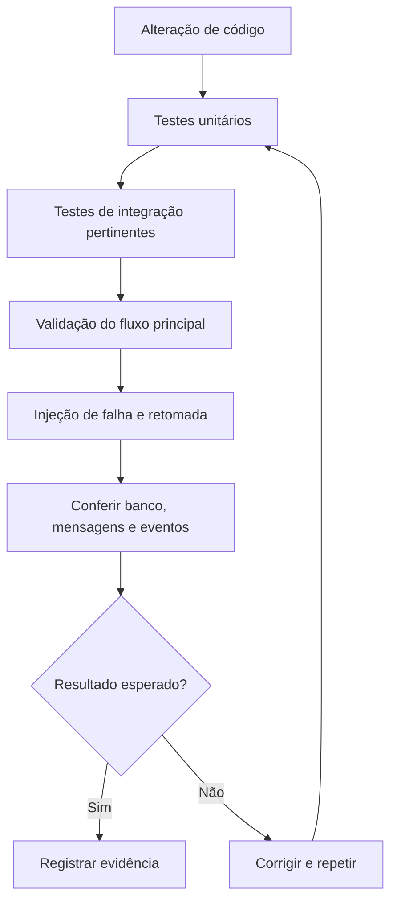

# ADR-015 — Estratégia de Testes

**Status:** Aceita — implementação incremental  
**Projeto:** OrderFlow  
**Escopo:** testes de domínio, aplicação, persistência, mensageria e Saga

## 1. Contexto

O OrderFlow é um laboratório de arquitetura distribuída em .NET 10 que utiliza Clean Architecture, DDD, CQRS, Entity Framework Core, SQL Server, RabbitMQ, Transactional Outbox, Inbox, Retry, DLQ e Saga orquestrada.

Nesse contexto, a correção não depende apenas da resposta de um método: também é necessário verificar persistência, transições de estado, entrega de mensagens, reprocessamento e recuperação após interrupções. A estratégia de testes deve diferenciar o que foi **validado** do que já possui **teste automatizado**, pois uma execução manual bem-sucedida não equivale, por si só, a uma suíte de regressão.

## 2. Decisão

Adotar uma estratégia incremental, combinando testes unitários, testes de integração e validações ponta a ponta orientadas a cenários de falha.

Os testes devem respeitar os limites arquiteturais: regras do domínio são verificadas isoladamente; casos de uso são verificados por seus contratos e dependências; integrações com SQL Server e RabbitMQ são exercitadas em ambientes controlados; e a Saga é avaliada também por seu **estado persistido** e pelos efeitos de reprocessamento.

A automação de cenários deve ser ampliada progressivamente. Nenhum cenário será declarado automatizado sem evidência no código de testes.

## 3. Níveis de teste

| Nível | Foco | Exemplos | Situação documentada |
|---|---|---|---|
| Unitário — Domain | Invariantes, entidades, transições e eventos | `Order`, `OrderItem`, regras de pagamento e cancelamento | Testes unitários do Domain já existentes |
| Unitário — Application | Commands, Queries, validação e coordenação de dependências | Handlers, `ValidationBehavior`, decisões de fluxo | Há testes da Application; cobertura específica deve ser verificada no repositório |
| Integração — Persistência | EF Core, SQL Server, mapeamentos e transações | Repositórios, Unit of Work, Outbox, estado da Saga | Ampliação/automação a verificar |
| Integração — Mensageria | Publicação, consumo, confirmação e redelivery | RabbitMQ, Inbox, Retry, DLQ | Cenários funcionais já validados; automação a verificar |
| Ponta a ponta / resiliência | Comportamento entre processos e após falhas | Pedido, pagamento, estoque e recuperação da Saga | Cenários específicos validados; não presumir automação |

## 4. Critérios gerais

- Verificar **resultado de negócio** e **estado persistido**, não apenas ausência de exceção.
- Repetir a mesma mensagem ou operação para avaliar **idempotência**.
- Interromper o processamento em pontos relevantes para testar **retomada**.
- Inspecionar efeitos colaterais: pedidos, pagamentos, reservas, registros de Inbox/Outbox e eventos gerados.
- Separar falhas transitórias de falhas permanentes e observar o comportamento de Retry e DLQ.
- Manter dados de teste independentes e previsíveis; evitar depender da ordem de execução.
- Registrar o tipo de evidência obtida: teste automatizado, execução manual, consulta ao banco ou inspeção de logs.

## 5. Cenários já validados — mensageria

Durante a evolução do OrderFlow foram relatadas validações funcionais de:

- Publicação e consumo de eventos com confirmação pelo consumidor.
- Persistência transacional do evento no Outbox.
- Recuperação da publicação após indisponibilidade do RabbitMQ.
- Recuperação após indisponibilidade do Worker de Outbox.
- Preservação dos dados do evento durante serialização e desserialização.
- Fluxos de Retry e encaminhamento para Dead Letter Queue (DLQ).

Essas validações demonstram comportamento observado nos cenários executados, **não** uma garantia universal de entrega exatamente uma vez. A arquitetura trabalha com entrega *at least once* e precisa de processamento idempotente.

## 6. Cenários já validados — Saga orquestrada

A Saga coordena o fluxo de pagamento e reserva de estoque e persiste seu progresso em `OrderSaga`.

### 6.1 Fluxo de sucesso

Foi validada a progressão do processo de negócio até a conclusão da Saga, com atualização do pedido e persistência dos estados intermediários.

### 6.2 Idempotência sequencial

Foi validado o reprocessamento sequencial nos handlers de pagamento e reserva de estoque, evitando repetir efeitos de negócio já concluídos.

**Limite da evidência:** isso não demonstra, por si só, proteção completa contra duas execuções concorrentes simultâneas. Esse caso requer testes próprios.

### 6.3 Recuperação após persistir `PAYMENT_COMPLETED`

Foi validada a retomada do processamento após a persistência desse estado, sem executar novamente indevidamente o pagamento já concluído.

### 6.4 Recuperação após persistir `INVENTORY_RESERVED`

Foi validada a retomada após a reserva de estoque já estar registrada, preservando a progressão da Saga sem duplicar a reserva.

### 6.5 Recuperação após `Order PAID` e antes de `Saga COMPLETED`

Foi validada a retomada nessa janela de falha. No cenário executado, ocorreu **exatamente um `OrderPaidDomainEvent`**, evitando duplicação desse evento de domínio.

### 6.6 Reprocessamento da Inbox

Foi validada a recuperação de uma mensagem da Inbox com transição de `FAILED` para `PROCESSED` após reprocessamento bem-sucedido.

> **Importante:** os cenários acima são apresentados como validações realizadas durante o desenvolvimento. A existência e a abrangência de testes automatizados correspondentes devem ser confirmadas nos projetos de teste.

## 7. Cenários pendentes ou que exigem confirmação

| Cenário | Objetivo | Situação |
|---|---|---|
| Compensação de pagamento | Verificar estorno/reembolso após falha de negócio | Pendente de implementação |
| Compensação de estoque | Verificar liberação de reserva após falha de negócio | Pendente de implementação |
| Falha durante compensação | Verificar retomada idempotente da compensação | Pendente de implementação |
| Concorrência | Verificar processamento simultâneo da mesma Saga/mensagem | Teste específico ainda não confirmado |
| Regressão automatizada da Saga | Reexecutar os cenários de recuperação de forma determinística | Automação ainda não confirmada |
| Integração com Testcontainers | Isolar dependências reais em testes reproduzíveis | Evolução planejada; implementação a verificar |
| Observabilidade distribuída | Correlacionar logs, métricas e traces por operação | Evolução planejada |

Falhas técnicas e falhas de negócio não devem ser tratadas como equivalentes: **Retry e recuperação** procuram concluir uma etapa interrompida; **compensações** procuram desfazer efeitos de negócio de etapas anteriormente concluídas.

## 8. Estratégia de execução

A injeção de falha deve ocorrer em pontos de persistência bem definidos. Após reiniciar ou reprocessar, é necessário comparar os registros anteriores e posteriores para verificar que a operação foi concluída sem efeitos duplicados.

## 9. Critérios de aceitação para evolução da Saga

A implementação de compensações somente poderá ser considerada validada quando houver evidências de que:

1. A falha de negócio dispara a compensação correta.
2. O estado da Saga registra a transição e o resultado correspondente.
3. O reprocessamento não repete indevidamente reembolso ou liberação de estoque.
4. Uma interrupção durante a compensação permite retomada segura.
5. O resultado final do pedido e dos recursos associados permanece coerente.

Esses critérios são **futuros** e não representam funcionalidades já entregues.

## 10. Consequências

**Benefícios:** maior confiança nas invariantes do domínio, detecção de regressões, evidências de recuperação e explicitação dos limites de idempotência e consistência eventual.

**Custos e cuidados:** testes distribuídos exigem infraestrutura, dados isolados, sincronização adequada e observação de efeitos persistidos. Testes manuais precisam ser gradualmente convertidos em cenários automatizados para reduzir o risco de regressão.

## 11. Documentação relacionada

- [`../concepts/13-Saga.md`](../concepts/13-Saga.md)
- [`ADR-017-Saga-Pattern.md`](ADR-017-Saga-Pattern.md)
- [`ADR-009-Outbox-Pattern.md`](ADR-009-Outbox-Pattern.md)
- [`ADR-010-Inbox-Pattern.md`](ADR-010-Inbox-Pattern.md)
- [`ADR-011-Idempotencia.md`](ADR-011-Idempotencia.md)
- [`ADR-012-Retry.md`](ADR-012-Retry.md)
- [`ADR-013-Dead-Letter-Queue.md`](ADR-013-Dead-Letter-Queue.md)
- [`../decisions/DEC-011-Por-que-Consistencia-Eventual.md`](../decisions/DEC-011-Por-que-Consistencia-Eventual.md)

---

**Situação da decisão:** estratégia definida e aplicada incrementalmente. A Saga possui cenários funcionais de recuperação e idempotência validados; compensações e a ampliação da automação permanecem como próximas etapas.
