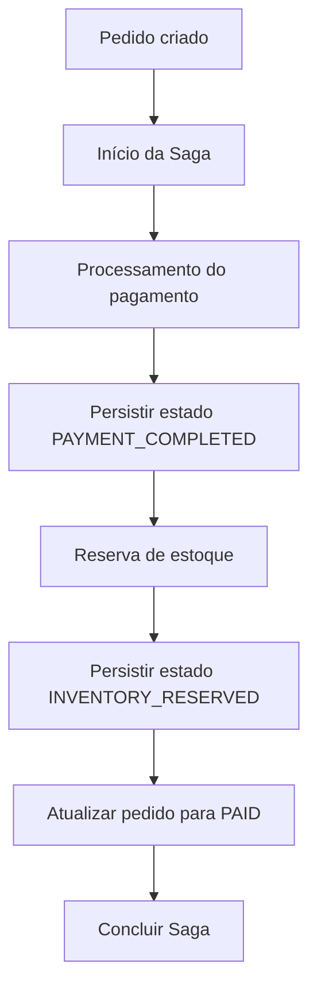

# DEC-011 — Por que Consistência Eventual?

**Projeto:** OrderFlow  
**Status:** Adotada  
**Escopo:** Integração assíncrona, processamento de pedidos e Saga orquestrada

---

## 1. Contexto

O OrderFlow é um laboratório de arquitetura distribuída desenvolvido em .NET 10, com SQL Server, RabbitMQ, Transactional Outbox, Inbox Pattern, idempotência, Retry e Dead Letter Queue (DLQ).

Em um processamento distribuído, as etapas de criação do pedido, pagamento e reserva de estoque não precisam ocorrer dentro de uma única transação de banco de dados. Cada etapa pode confirmar sua própria alteração e comunicar seu resultado de forma assíncrona.

Consequentemente, durante um intervalo, os componentes podem observar estados diferentes do mesmo processo de negócio. Esse comportamento exige uma estratégia explícita para acompanhar o progresso e lidar com falhas.

## 2. Decisão

Adotar **consistência eventual** para a coordenação dos processos assíncronos do OrderFlow, mantendo **consistência transacional local** nas operações que precisam ser confirmadas atomicamente no mesmo banco de dados.

A decisão é apoiada pelos seguintes mecanismos:

- **Transactional Outbox:** registra a intenção de publicação junto às alterações locais, reduzindo o risco de persistir uma alteração sem registrar o evento correspondente.
- **RabbitMQ:** transporta mensagens entre os componentes de forma assíncrona.
- **Inbox Pattern e idempotência:** permitem identificar e tratar mensagens repetidas, considerando que uma mensagem pode ser entregue mais de uma vez.
- **Retry e DLQ:** tratam falhas de mensageria conforme a política definida para erros transitórios e permanentes.
- **Saga orquestrada:** acompanha as etapas do processo de pedido, com estado persistido em `OrderSaga`, permitindo retomar o fluxo após determinadas interrupções.

A consistência eventual **não significa ausência de regras de consistência**: as invariantes do domínio e os limites das transações locais continuam sendo respeitados.

## 3. Por que não uma transação distribuída única?

Uma transação abrangendo todas as etapas do fluxo criaria acoplamento entre os participantes e exigiria coordenação transacional entre recursos distintos.

No OrderFlow, a opção é dividir o processo em transações locais e coordenar sua evolução por mensagens e estados persistidos. Isso favorece desacoplamento, recuperação e evolução incremental, mas exige tratamento explícito de duplicidade, falhas e estados intermediários.

Essa decisão é coerente com a escolha de **Saga orquestrada** registrada em `docs/adr/ADR-017-Saga-Pattern.md`.

## 4. Aplicação no fluxo de pedidos

O fluxo de sucesso implementado coordena o processamento do pagamento e a reserva de estoque, registrando o avanço da Saga até a conclusão do pedido.

O diagrama representa o **caminho de sucesso**, não uma transação única nem a descrição de todos os detalhes internos de publicação e consumo.

Entre as etapas, o processo pode estar temporariamente incompleto. O estado persistido da Saga permite identificar o ponto alcançado e orientar a retomada.

## 5. Entrega de mensagens e idempotência

A arquitetura trabalha com o modelo **At Least Once Delivery**: mensagens podem ser entregues novamente, especialmente após falhas ou interrupções.

Por isso, não se presume execução exatamente uma vez (*exactly once*) em toda a cadeia distribuída. A proteção contra efeitos de negócio duplicados depende de mecanismos de idempotência e do estado persistido.

No fluxo da Saga, o processamento idempotente de pagamento e reserva de estoque foi validado para os cenários de recuperação implementados.

## 6. Recuperação após falhas

Foram validados cenários de retomada após interrupções em pontos específicos:

1. Após a persistência de `PAYMENT_COMPLETED`.
2. Após a persistência de `INVENTORY_RESERVED`.
3. Após a persistência do pedido como `PAID`, antes de a Saga ser marcada como `COMPLETED`.

No terceiro cenário, a recuperação foi validada sem duplicação do `OrderPaidDomainEvent`.

Também foi validado o reprocessamento de mensagem no Inbox, com evolução de `FAILED` para `PROCESSED`.

Essas validações demonstram o comportamento dos **cenários testados**; não representam garantia de recuperação automática para toda falha possível.

## 7. Recuperação técnica não é compensação de negócio

É importante distinguir dois tipos de tratamento:

| Situação | Tratamento |
|---|---|
| Falha técnica transitória na entrega ou no processamento | Retry, reprocessamento, idempotência e retomada a partir do estado persistido, conforme o cenário |
| Falha permanente de mensageria | Isolamento em DLQ, conforme a política de mensageria |
| Falha de negócio após uma etapa já confirmada | Pode exigir uma **ação compensatória**, como estorno de pagamento ou liberação de estoque |

**Estado atual:** a Saga orquestrada, o fluxo de sucesso e os cenários de recuperação citados estão implementados e validados. As **compensações de pagamento e de estoque ainda não foram implementadas**.

Portanto, Retry e DLQ não substituem compensações de negócio.

## 8. Consequências da decisão

### Benefícios

- Menor acoplamento temporal entre etapas assíncronas.
- Possibilidade de retomar processos com base em estados persistidos.
- Integração com mecanismos de entrega e reprocessamento de mensagens.
- Evolução incremental dos componentes e do fluxo distribuído.

### Custos e limitações

- Existência de estados intermediários temporariamente inconsistentes entre componentes.
- Maior complexidade de diagnóstico e acompanhamento do fluxo.
- Necessidade de idempotência, tratamento de falhas e políticas de recuperação.
- Necessidade de compensações quando uma falha de negócio exige desfazer efeitos já confirmados.
- Ausência de garantia geral de processamento exatamente uma vez em todo o sistema.

## 9. Próximos passos

A evolução prevista para o Capítulo 14 inclui implementar e validar as compensações de pagamento e reserva de estoque, com estados e transições adequados ao fluxo de falhas de negócio.

A documentação deverá ser revisada novamente quando essas funcionalidades estiverem efetivamente implementadas.

## 10. Documentos relacionados

- [`13-Saga.md`](../concepts/13-Saga.md) — conceitos e evolução da Saga.
- [`ADR-017-Saga-Pattern.md`](../adr/ADR-017-Saga-Pattern.md) — decisão pela Saga orquestrada.
- [`08-Outbox-Pattern.md`](../concepts/08-Outbox-Pattern.md) — persistência e publicação de eventos.
- [`09-Inbox-Pattern.md`](../concepts/09-Inbox-Pattern.md) — controle do processamento de mensagens.
- [`10-Idempotencia.md`](../concepts/10-Idempotencia.md) — prevenção de efeitos duplicados.
- [`11-Retry.md`](../concepts/11-Retry.md) — tratamento de falhas transitórias.
- [`12-Dead-Letter-Queue.md`](../concepts/12-Dead-Letter-Queue.md) — isolamento de mensagens problemáticas.
- [`Fluxo-Pagamento.md`](../diagrams/Fluxo-Pagamento.md) — representação do fluxo de pagamento e Saga.
