# Arquitetura Geral

## Visão Geral

O **OrderFlow** é um laboratório de arquitetura distribuída desenvolvido em **.NET 10**, cujo objetivo é demonstrar a implementação prática de padrões utilizados em sistemas corporativos modernos.

A solução foi construída seguindo os princípios de:

- Clean Architecture
- Domain-Driven Design (DDD)
- CQRS
- Domain Events
- Repository Pattern
- Unit of Work
- RabbitMQ
- Event-Driven Architecture
- Worker Pattern
- Retry
- Dead Letter Queue (DLQ)
- Transactional Outbox
- Inbox Pattern e idempotência
- Saga orquestrada com estado persistido
- Recuperação de processamento após falhas

A arquitetura mantém forte separação entre regras de negócio e infraestrutura, permitindo baixo acoplamento, alta coesão e facilidade de evolução.

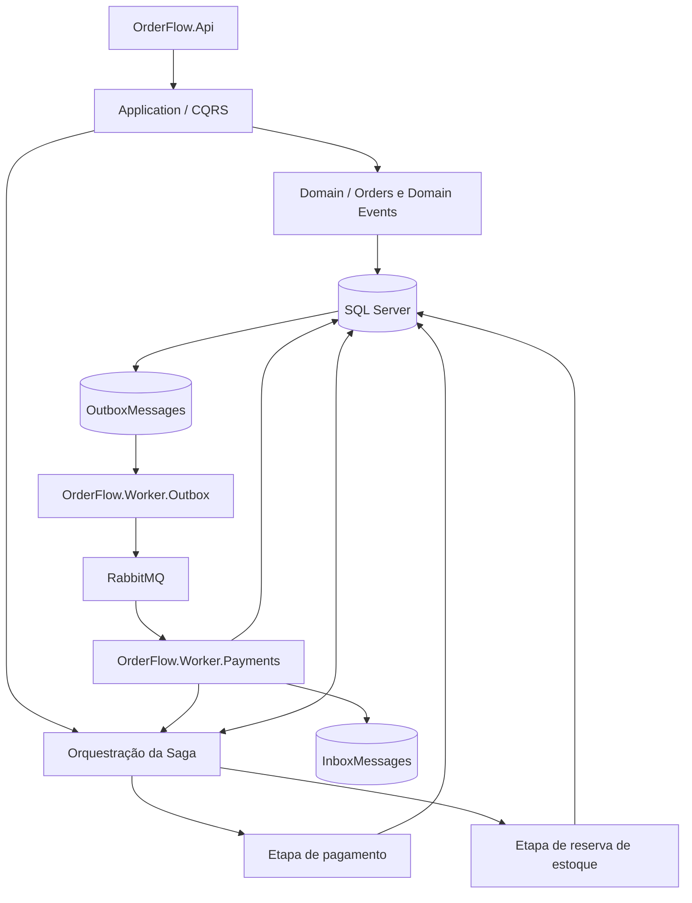

O diagrama é **conceitual**: representa responsabilidades e comunicação, não uma correspondência obrigatória entre cada caixa e uma classe ou processo físico. O estado da Saga é persistido em `OrderSaga`; o processamento das mensagens utiliza a infraestrutura existente de RabbitMQ, Outbox e Inbox.

---

# Visão Arquitetural

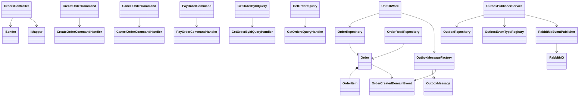

---

# Arquitetura dos Workers

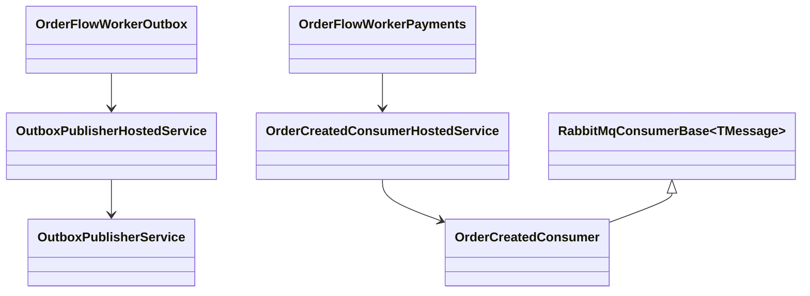

---

# Fluxo de Escrita (CQRS)

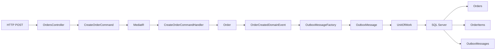

---

# Fluxo Transactional Outbox

```mermaid
flowchart LR

A[SQL Server]
--> B[OutboxMessages]
--> C[OrderFlow.Worker.Outbox]
--> D[OutboxPublisherHostedService]
--> E[OutboxPublisherService]
--> F[OutboxEventTypeRegistry]
--> G[RabbitMqEventPublisher]
--> H[RabbitMQ Exchange]
--> I[orderflow.order-created]
--> J[OrderFlow.Worker.Payments]
--> K[OrderCreatedConsumer]
--> L[ACK]
```
---

# Fluxo de Leitura (CQRS)

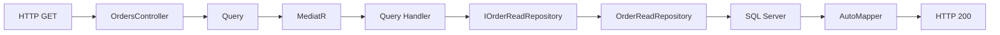

---

# Fluxo de Processamento Assíncrono

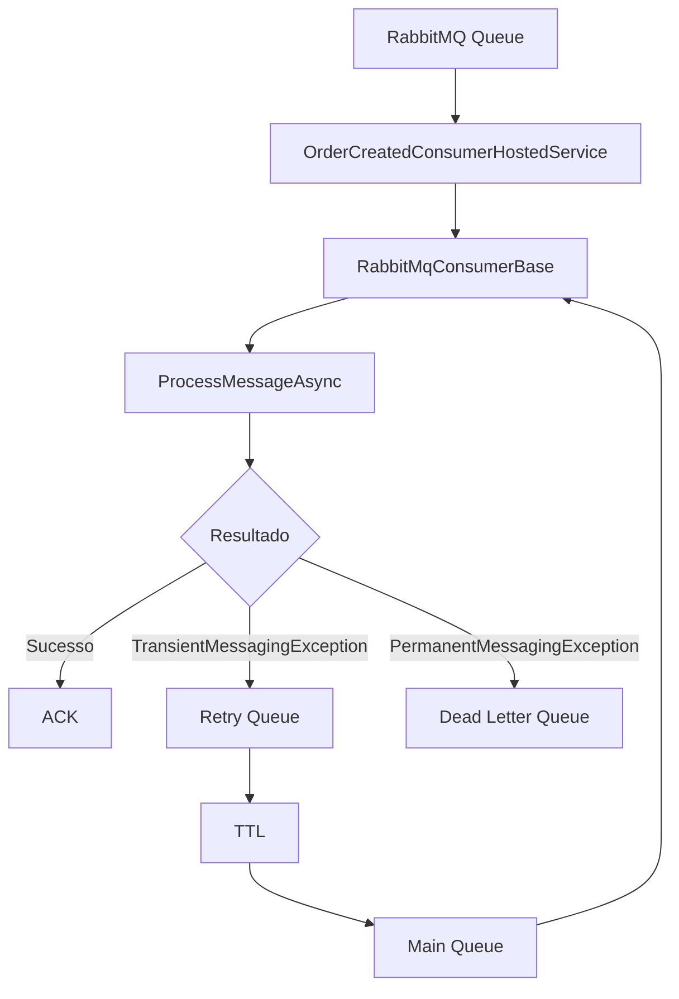

---

# Topologia RabbitMQ

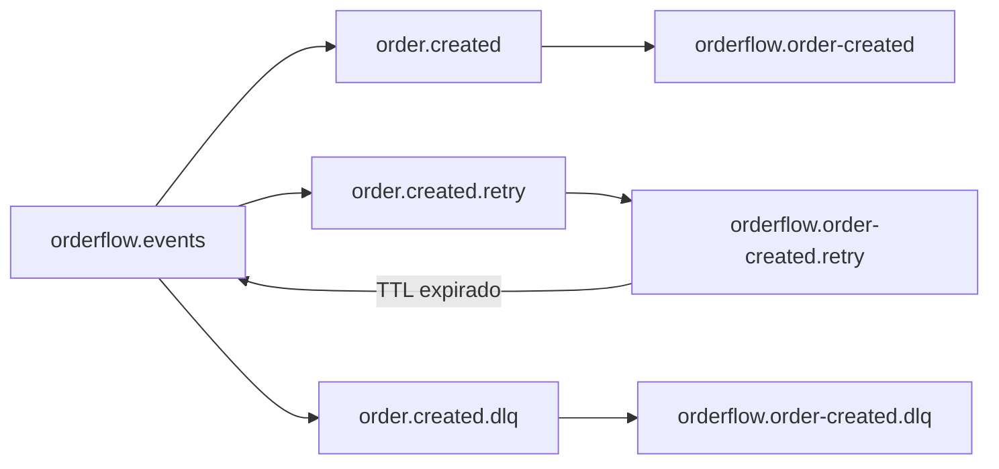

---

# Hierarquia das Exceções

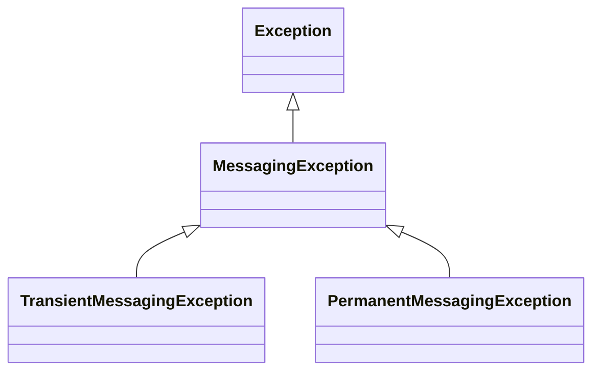

---

# Fluxo de Retry

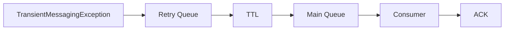

---

# Fluxo de Dead Letter Queue

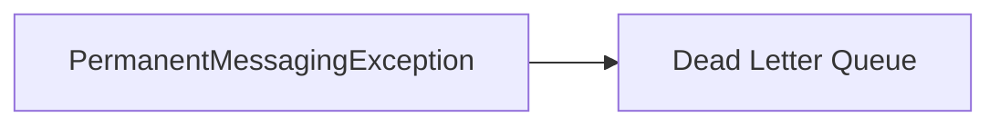

---

# Fluxo de Persistência Transacional

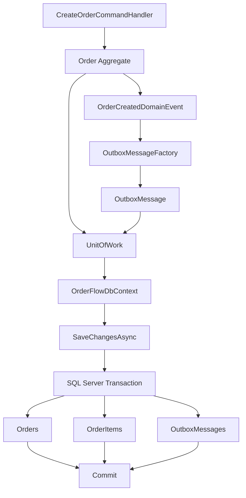
---

# Responsabilidades das Camadas

| Camada / Processo | Responsabilidade |
|---|---|
| **Api** | Receber requisições HTTP, mapear contratos, enviar Commands e Queries e produzir respostas HTTP. |
| **Application** | Orquestrar casos de uso, validar entradas e depender apenas de abstrações. |
| **Domain** | Concentrar entidades, regras de negócio, invariantes, transições de estado e Domain Events. |
| **Infrastructure** | Implementar persistência, SQL Server, Unit of Work, Transactional Outbox, Inbox, RabbitMQ, Retry, Dead Letter Queue e integrações externas. |
| **OrderFlow.Worker.Outbox** | Consultar mensagens não processadas na tabela `OutboxMessages`, desserializar os eventos, publicá-los no RabbitMQ e preencher `ProcessedOnUtc` após o sucesso. |
| **OrderFlow.Worker.Payments** | Consumir mensagens do RabbitMQ, executar o processamento de negócio com proteção contra duplicidades e confirmar o processamento conforme a política do consumer. |
| **Orquestração da Saga** | Coordenar as etapas de pagamento e reserva de estoque, persistir o progresso e permitir retomada segura após falhas técnicas. |

---

# Princípios Arquiteturais

A arquitetura do OrderFlow foi construída utilizando os seguintes princípios e padrões:

- Clean Architecture
- Domain-Driven Design (DDD)
- CQRS
- Domain Events
- Repository Pattern
- Unit of Work
- Dependency Injection
- RabbitMQ
- Event-Driven Architecture
- Worker Pattern
- Retry
- Dead Letter Queue (DLQ)
- Transactional Outbox
- At Least Once Delivery
- Consistência Eventual
- Inbox Pattern
- Idempotência
- Saga orquestrada

---

# Observações Arquiteturais

A camada **Domain** permanece completamente independente de frameworks, banco de dados, HTTP ou RabbitMQ.

A camada **Application** depende apenas de abstrações, preservando o desacoplamento entre regras de negócio e infraestrutura.

Toda a infraestrutura de persistência e mensageria permanece centralizada na camada **Infrastructure**.

O `RabbitMqConsumerBase<TMessage>` concentra toda a política de processamento de mensagens, incluindo:

- desserialização;
- ACK;
- Retry;
- Dead Letter Queue;
- republicação;
- controle do header `x-orderflow-retry-count`;
- classificação entre falhas transitórias e permanentes.

Os Consumers concretos permanecem responsáveis exclusivamente pela lógica de negócio, desconhecendo detalhes de infraestrutura como ACK, Retry, DLQ e republicação de mensagens.

## Transactional Outbox

O **Transactional Outbox Pattern** foi implementado para garantir consistência entre a persistência do banco de dados e a publicação de eventos no RabbitMQ.

Os Domain Events são convertidos em registros da tabela `OutboxMessages` durante a mesma transação utilizada para persistir o Aggregate Root.

Após a confirmação da transação, o `OrderFlow.Worker.Outbox` consulta periodicamente as mensagens ainda não processadas, desserializa os eventos, publica-os no RabbitMQ e atualiza o campo `ProcessedOnUtc`.

Essa abordagem evita a perda do evento quando a transação de negócio é confirmada mas o broker está indisponível. A publicação é assíncrona e pode ocorrer mais de uma vez; por isso, o processamento deve ser idempotente. O padrão oferece consistência eventual, não uma transação distribuída única nem garantia de entrega exatamente uma vez.

## Cenários Validados

Durante a implementação foram executados e validados os seguintes cenários:

- publicação normal de eventos;
- RabbitMQ indisponível durante a criação do pedido;
- recuperação automática após o retorno do RabbitMQ;
- Worker.Outbox indisponível durante a criação do pedido;
- recuperação automática após a inicialização do Worker.Outbox;
- preservação de `EventId`, `OccurredAt` e `Payload` durante a serialização e desserialização;
- processamento completo até o ACK do Consumer.

Esses cenários validam a recuperação do fluxo de publicação e consumo nas condições testadas, sem dispensar testes adicionais de concorrência e falhas não simuladas.

---

# Saga Orquestrada — Capítulo 14

A Saga orquestrada coordena a conclusão do pedido por meio de etapas de negócio, com **estado persistido** em `OrderSaga`. O fluxo de sucesso inclui processamento do pagamento, reserva de estoque e atualização do pedido para **PAID**; após a conclusão, a Saga passa para **COMPLETED**.

A coordenação é lógica e não depende de uma transação única abrangendo todas as etapas. Cada progresso confirmado deve ser persistido, de modo que a retomada possa identificar o que já ocorreu e evitar executar novamente efeitos de negócio concluídos.

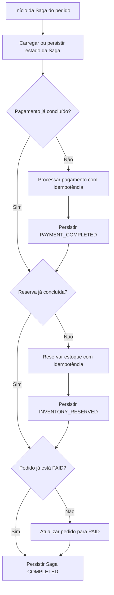

O diagrama descreve o **caminho de sucesso e retomada técnica**. Não representa compensações já implementadas.

## Persistência, Inbox e idempotência

O estado persistido da Saga permite retomar o processamento após uma interrupção. A Inbox protege o processamento de mensagens repetidas e pode registrar a passagem de `FAILED` para `PROCESSED` após reprocessamento bem-sucedido. Além disso, as etapas de pagamento e reserva de estoque aplicam verificações de idempotência de negócio, necessárias porque a entrega de mensagens pode ocorrer mais de uma vez.

A inicialização da topologia RabbitMQ é realizada pelo `RabbitMqTopologyHostedService`. Retry e DLQ tratam a política de entrega e falhas de mensageria; **não substituem compensações de negócio**.

## Cenários de recuperação validados

Foram validadas retomadas após interrupções em três pontos do fluxo:

1. Depois da persistência de `PAYMENT_COMPLETED`.
2. Depois da persistência de `INVENTORY_RESERVED`.
3. Depois de o pedido ser persistido como `PAID`, mas antes de a Saga ser persistida como `COMPLETED`.

No terceiro cenário, foi observado **um único `OrderPaidDomainEvent`**. Também foi validado o reprocessamento de mensagem da Inbox de `FAILED` para `PROCESSED`.

Essas verificações demonstram o comportamento observado nos cenários testados; não constituem garantia geral de *exactly-once* nem comprovam proteção completa contra concorrência.

## Evolução pendente: compensações

As compensações ainda **não foram implementadas**. A próxima evolução prevista inclui reversão de pagamento e liberação de reserva de estoque quando uma falha de negócio exigir desfazer efeitos já confirmados. O desenho de estados e a política de falhas devem distinguir retomada técnica de compensação de negócio.

## Documentação relacionada

- [Conceito — Saga](../concepts/13-Saga.md)
- [ADR-017 — Saga Pattern](../adr/ADR-017-Saga-Pattern.md)
- [Fluxo de Pagamento](Fluxo-Pagamento.md)
- [Fluxo de Inbox](Fluxo-Inbox.md)
- [Fluxo de Outbox](Fluxo-Outbox.md)
- [Evolução da Arquitetura](Evolucao-da-Arquitetura.md)
