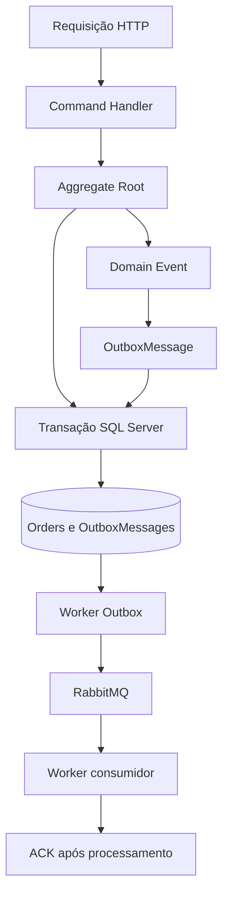
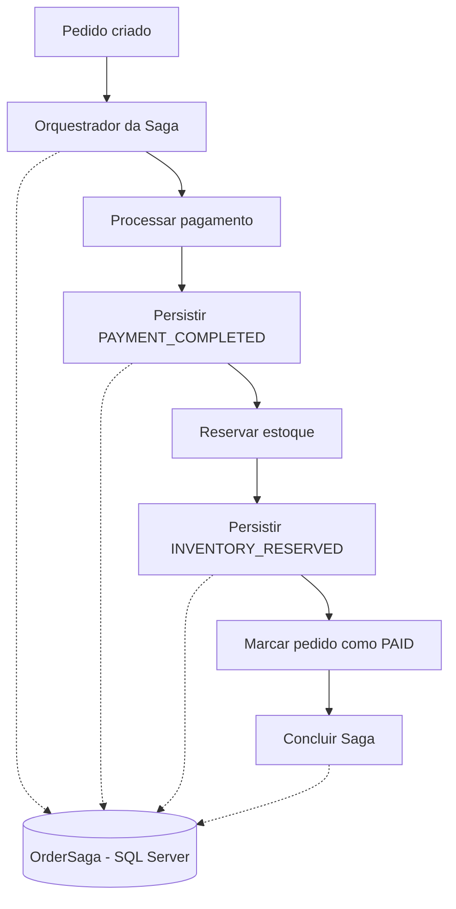
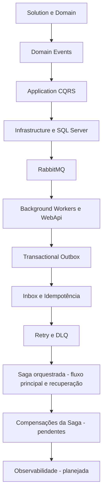
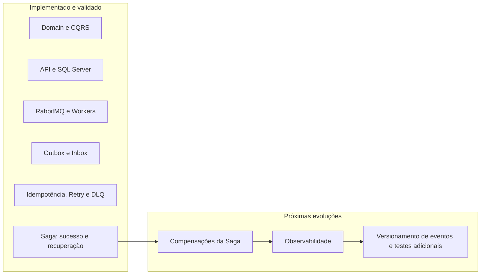

# Evolução da Arquitetura — OrderFlow

## Visão geral

O **OrderFlow** é um laboratório de arquitetura de software em **.NET 10**, desenvolvido incrementalmente para estudar e validar padrões de aplicações distribuídas. Este documento registra as entregas arquiteturais e diferencia funcionalidades implementadas de evoluções planejadas.

> **Nota sobre a numeração:** o histórico original deste documento utiliza uma sequência de capítulos diferente daquela apresentada no `README.md`, especialmente para WebApi, Workers e Outbox. A visão de progresso abaixo utiliza a numeração atual do README, preservando os componentes técnicos documentados.

---

## Capítulos 1 e 2 — Estrutura da Solution e Domain Model

A solução foi estruturada seguindo os princípios da **Clean Architecture**, com separação entre Domain, Application, Infrastructure, API e processos de execução independentes.

Foi construída a camada **Domain**, com:

- Aggregate Root `Order`;
- entidade `OrderItem`;
- Domain Exceptions;
- abstrações de repositórios;
- invariantes e regras de negócio;
- testes unitários.

**Status:** Concluído.

---

## Capítulo 3 — Domain Events

Foram introduzidos os eventos de domínio:

- `OrderCreatedDomainEvent`;
- `OrderCancelledDomainEvent`;
- `OrderPaidDomainEvent`.

A classe base `Entity` oferece suporte ao gerenciamento dos Domain Events.

**Status:** Concluído.

---

## Capítulo 4 — Application (CQRS)

A camada **Application** foi construída utilizando **CQRS**, **MediatR** e **FluentValidation**.

| Categoria | Componentes |
|---|---|
| Commands | `CreateOrder`, `CancelOrder`, `PayOrder` |
| Queries | `GetOrderById`, `GetOrders` |
| Behavior implementado | `ValidationBehavior` |
| Abstrações | `IUnitOfWork`, `IOrderRepository`, `IOrderReadRepository` |
| Organização | Vertical Slice Architecture |

**Status:** Concluído para o escopo registrado.

---

## Capítulo 5 — Infrastructure

A infraestrutura de persistência foi implementada com **Entity Framework Core** e **SQL Server**.

**Principais componentes e recursos:**

- `OrderFlowDbContext`, Fluent API e Entity Configurations;
- Change Tracking, Backing Fields e Shadow Properties;
- `OrderRepository`, `OrderReadRepository` e `UnitOfWork`;
- Dependency Injection e User Secrets;
- migrations, índices, foreign keys e Model Snapshot.

**Status:** Concluído para o escopo inicial, com evolução contínua conforme novos padrões são adicionados.

---

## Capítulo 6 — RabbitMQ

Foi construída a infraestrutura de mensageria, com publicação e consumo de mensagens.

**Componentes documentados:**

- `RabbitMqConnection`;
- `RabbitMqChannelFactory`;
- inicialização de topologia por `RabbitMqTopologyHostedService`;
- `RabbitMqRoutingKeyResolver`;
- `RabbitMqEventPublisher`;
- exchanges, queues, bindings e routing keys;
- Publisher Confirms;
- Manual ACK, QoS e Prefetch;
- `RabbitMqConsumerBase<TMessage>`;
- `OrderCreatedConsumer` e `OrderCreatedConsumerHostedService`.

Foi validada a comunicação entre a API e um Worker independente por meio do RabbitMQ.

**Status:** Concluído.

---

## Capítulo 7 — Background Workers

A arquitetura passou a executar processamento assíncrono por meio de Workers independentes, incluindo:

- `OrderFlow.Worker.Payments`;
- `OrderFlow.Worker.Outbox`;
- serviços hospedados para consumo e publicação de mensagens.

O processamento separa o recebimento de eventos da execução de tarefas em segundo plano.

**Status:** Concluído para os fluxos documentados.

---

## Capítulo 8 — WebApi

Foi implementada a API REST, incluindo:

- `OrdersController`;
- `POST /orders`;
- `GET /orders`;
- `GET /orders/{id}`;
- `PATCH /orders/{id}/pay`;
- `PATCH /orders/{id}/cancel`;
- API Versioning, Swagger/OpenAPI, AutoMapper e Contracts;
- integração com MediatR.

**Status:** Concluído.

---

## Capítulo 9 — Transactional Outbox Pattern

### Objetivo

Persistir alterações de negócio e mensagens de saída na mesma transação de banco de dados, evitando que a confirmação de uma alteração dependa da disponibilidade imediata do RabbitMQ.

### Componentes

- `OutboxMessage` e `OutboxMessageConfiguration`;
- `IOutboxMessageFactory` e `OutboxMessageFactory`;
- `IOutboxRepository` e `OutboxRepository`;
- `IOutboxEventTypeRegistry` e `OutboxEventTypeRegistry`;
- `OutboxPublisherService` e `OutboxPublisherHostedService`;
- `OrderFlow.Worker.Outbox`.

### Fluxo

### Benefícios e validações

- Persistência transacional de pedidos e mensagens de saída;
- publicação assíncrona com modelo **At Least Once Delivery**;
- recuperação após indisponibilidade do RabbitMQ;
- recuperação após indisponibilidade do Worker.Outbox;
- preservação de `EventId`, `OccurredAt` e `Payload` na serialização;
- publicação e consumo validados de ponta a ponta.

> O Outbox evita a perda da intenção de publicar o evento após o commit local, mas não garante entrega *exactly once*. Consumidores devem continuar preparados para duplicidades.

**Status:** Concluído.

---

## Capítulo 10 — Inbox Pattern

O Inbox registra o recebimento e o estado de processamento das mensagens, permitindo deduplicação e reprocessamento controlado.

Foi validada a recuperação de uma mensagem com estado `FAILED` até `PROCESSED`.

**Status:** Concluído para o fluxo implementado.

---

## Capítulo 11 — Idempotência

A arquitetura utiliza mecanismos de idempotência para reduzir os efeitos de entregas repetidas e reexecuções, inclusive nos processamentos de pagamento e reserva de estoque da Saga.

A idempotência é especialmente importante porque a entrega de mensagens segue o modelo **At Least Once**.

**Status:** Concluído para os cenários implementados e validados.

---

## Capítulo 12 — Retry

O processamento de mensagens diferencia falhas transitórias, que podem ser reprocessadas, de falhas permanentes.

O fluxo de Retry utiliza filas de retentativa e retorno ao processamento após o intervalo configurado, com controle do número de tentativas.

**Status:** Concluído.

---

## Capítulo 13 — Dead Letter Queue (DLQ)

Mensagens que apresentam falhas permanentes ou esgotam a política de Retry são isoladas em uma **Dead Letter Queue**, preservando informações necessárias à investigação e à operação.

**Status:** Concluído.

---

## Capítulo 14 — Saga Pattern

### Decisão arquitetural

Foi adotada uma **Saga orquestrada** para coordenar o fluxo distribuído de pedidos, pagamentos e reserva de estoque. A alternativa coreografada foi considerada, mas não é o modelo implementado nesta etapa.

### Funcionalidades implementadas

- Coordenação sequencial do fluxo de sucesso;
- persistência do estado da Saga em `OrderSaga`;
- processamento idempotente de pagamento e reserva de estoque;
- retomada do fluxo após interrupções em pontos previamente persistidos;
- integração com os mecanismos existentes de mensageria, Outbox e Inbox.

### Cenários de recuperação validados

1. Retomada após a persistência do estado `PAYMENT_COMPLETED`;
2. Retomada após a persistência do estado `INVENTORY_RESERVED`;
3. Retomada após a persistência de `Order PAID`, antes da conclusão da Saga, sem duplicar o `OrderPaidDomainEvent`;
4. Reprocessamento de mensagem Inbox de `FAILED` para `PROCESSED`.

### Fluxo lógico implementado

O diagrama representa a sequência lógica de negócio e seus marcos persistidos, não uma especificação detalhada de transporte ou de limites transacionais.

### Pendências

- Compensação de pagamento, por meio de estorno ou operação equivalente;
- liberação da reserva de estoque;
- definição e validação dos fluxos de falha de negócio que acionam compensações.

**Status:** Em andamento — fluxo de sucesso, idempotência e recuperação técnica implementados e validados; compensações pendentes.

**Documentação relacionada:**

- [`../concepts/13-Saga.md`](../concepts/13-Saga.md)
- [`../adr/ADR-017-Saga-Pattern.md`](../adr/ADR-017-Saga-Pattern.md)

---

## Capítulo 15 — Observabilidade

Etapa prevista para evolução dos recursos de:

- logs estruturados;
- métricas;
- rastreamento distribuído;
- OpenTelemetry.

**Status:** Planejado.

---

## Linha de evolução da arquitetura

## Situação atual

## Observações finais

O OrderFlow evolui incrementalmente, consolidando implementações, validações e decisões arquiteturais antes de avançar para novos padrões. **Recuperação técnica** (retomar processamento após falhas) e **compensação de negócio** (desfazer efeitos já confirmados) são responsabilidades distintas: a primeira já possui cenários validados na Saga; a segunda é uma evolução pendente.

Este documento descreve o estágio registrado do projeto, sem antecipar funcionalidades ainda não implementadas.
