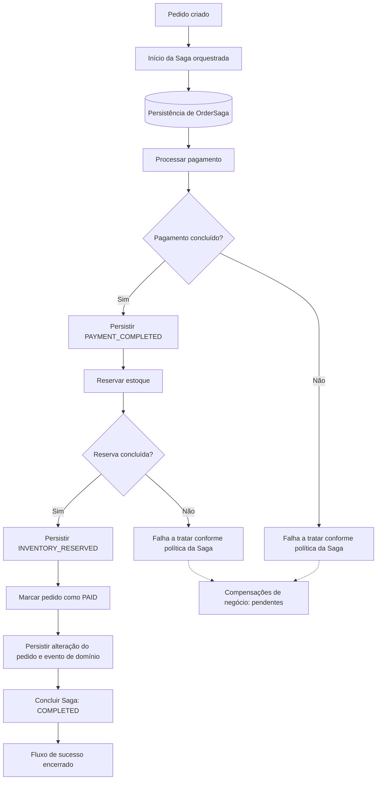
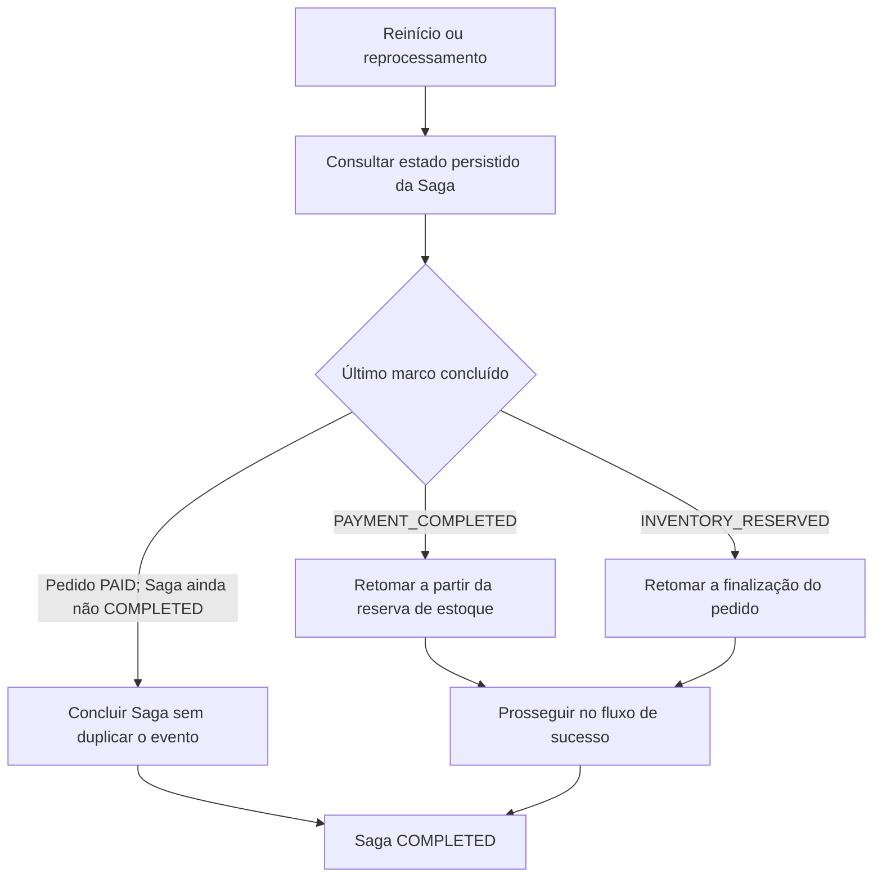

# Fluxo de Pagamento — Saga Orquestrada

## Objetivo

Documentar o processamento de pagamento de pedidos no OrderFlow, sua integração com a reserva de estoque e os mecanismos de persistência, idempotência e recuperação da Saga.

> **Estado atual:** o fluxo de sucesso da Saga orquestrada e os cenários de recuperação descritos abaixo foram validados. As compensações de estorno de pagamento e liberação de estoque ainda não foram implementadas.

## Visão geral

O processamento é coordenado por uma **Saga orquestrada**. Seu estado é persistido em `OrderSaga`, permitindo que o fluxo retome a partir das etapas concluídas após uma interrupção. Os handlers de pagamento e de reserva de estoque possuem proteção contra processamento sequencial duplicado.

A arquitetura utiliza SQL Server, RabbitMQ e os padrões Transactional Outbox e Inbox para apoiar o processamento assíncrono e a recuperação de mensagens. O transporte opera sob a possibilidade de entregas repetidas; por isso, não se pressupõe execução *exactly once*.

## Fluxo de sucesso

O diagrama é **conceitual**: mostra a ordem lógica das etapas, sem afirmar que cada seta corresponde a uma mensagem RabbitMQ específica ou a uma transação única.

## Persistência e estados

| Marco | Significado |
|---|---|
| `PAYMENT_COMPLETED` | O pagamento foi concluído e essa etapa foi registrada na Saga. |
| `INVENTORY_RESERVED` | A reserva de estoque foi concluída e registrada na Saga. |
| Pedido `PAID` | O pedido foi atualizado para pago. |
| Saga `COMPLETED` | O fluxo de sucesso foi finalizado. |

A persistência de `OrderSaga` é essencial para identificar o último marco confirmado. Os nomes acima representam os marcos relevantes aos cenários validados; não pretendem enumerar todos os estados internos possíveis.

## Idempotência e processamento de mensagens

- Os handlers de pagamento e de reserva de estoque foram validados quanto à **idempotência sequencial**: repetir o processamento não deve repetir o efeito de negócio já concluído.
- O **Inbox Pattern** registra o processamento das mensagens e permite reprocessar mensagens que estavam em `FAILED`, levando-as a `PROCESSED` após a recuperação bem-sucedida.
- **Retry** e **DLQ** tratam falhas de mensageria conforme a política de infraestrutura. Não substituem compensações de negócio.
- A topologia RabbitMQ é inicializada pelo `RabbitMqTopologyHostedService`.

A idempotência sequencial validada não deve ser confundida com uma garantia geral de ausência de condições de corrida em processamento concorrente.

## Cenários de recuperação validados

Foram validados os seguintes pontos de interrupção:

1. **Após persistir `PAYMENT_COMPLETED`:** a retomada preserva o pagamento já concluído.
2. **Após persistir `INVENTORY_RESERVED`:** a retomada preserva a reserva já concluída.
3. **Após persistir o pedido como `PAID`, antes de concluir a Saga:** a retomada finaliza a Saga sem emitir novamente o `OrderPaidDomainEvent`; no cenário validado, ocorreu exatamente **um** evento.

Também foi validado o reprocessamento de mensagem no Inbox, com transição de `FAILED` para `PROCESSED`.

## Tratamento de falhas: estado atual e evolução

É importante separar duas categorias:

| Categoria | Finalidade | Situação |
|---|---|---|
| Recuperação técnica | Retomar etapas após interrupções, redelivery ou falhas transitórias, respeitando o estado persistido. | Implementada e validada nos cenários descritos. |
| Compensação de negócio | Desfazer efeitos de etapas anteriores quando o fluxo não puder prosseguir. | **Pendente.** |

As próximas evoluções previstas são o **estorno do pagamento** e a **liberação da reserva de estoque**, com definição explícita das transições, da idempotência e da política de falhas de cada compensação.

## Relação com outros documentos

- [`../concepts/13-Saga.md`](../concepts/13-Saga.md) — fundamentos e implementação da Saga.
- [`../adr/ADR-017-Saga-Pattern.md`](../adr/ADR-017-Saga-Pattern.md) — decisão arquitetural pela orquestração.
- [`Arquitetura-Geral.md`](Arquitetura-Geral.md) — visão integrada dos componentes.
- [`Fluxo-Inbox.md`](Fluxo-Inbox.md) — processamento e controle das mensagens recebidas.
- [`Fluxo-Outbox.md`](Fluxo-Outbox.md) — publicação confiável de eventos.
- [`Fluxo-Retry.md`](Fluxo-Retry.md) e [`Fluxo-DLQ.md`](Fluxo-DLQ.md) — políticas de falhas de mensageria.

## Status

**Capítulo 14 — Em andamento.** Fluxo de sucesso, persistência de estado, idempotência sequencial e recuperação validados; compensações ainda pendentes.
